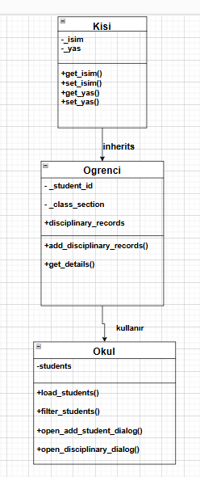

# Öğrenci Yönetim Sistemi

Üniversitenin ilk yıllarında Python ve PyQt5 ile geliştirdiğim öğrenci yönetimi masaüstü projesi. Nesne yönelimli programlama ve grafik arayüz geliştirme pratiği amacıyla hazırlanmıştır.

## Özellikler

- Yönetici giriş ekranı
- Öğrenci ekleme, listeleme ve silme
- Öğrenci adı ve sınıfına göre arama
- Disiplin kaydı ekleme ve silme
- Öğrenci verilerini JSON dosyasında saklama
- Sınıf ve şubeye göre sıralama

## Kurulum ve çalıştırma

Python 3 ve pip gereklidir. Terminali proje klasöründe açın:

```sh
python -m venv .venv
```

Windows PowerShell üzerinde sanal ortamı etkinleştirin:

```powershell
.\.venv\Scripts\Activate.ps1
```

Bağımlılığı yükleyip uygulamayı başlatın:

```sh
python -m pip install -r requirements.txt
python ÖğrenciYönetimSistemi.py
```

Demo giriş bilgileri: kullanıcı adı `admin`, şifre `12345`.
Sınıf-şube alanını `9-A` gibi sayı ve şube harfi biçiminde girin.

Uygulama, öğrenci eklediğinizde çalıştırıldığı klasörde `students.json` dosyasını oluşturur. Yerel öğrenci kayıtları Git deposuna dahil edilmez.

## UML diyagramı



## Proje hakkında

Bu depo, öğrenme sürecinde hazırlanan projenin özgün halini paylaşmak için oluşturulmuştur. Giriş bilgileri kod içinde sabittir; uygulama eğitim ve demo kullanımına yöneliktir.
